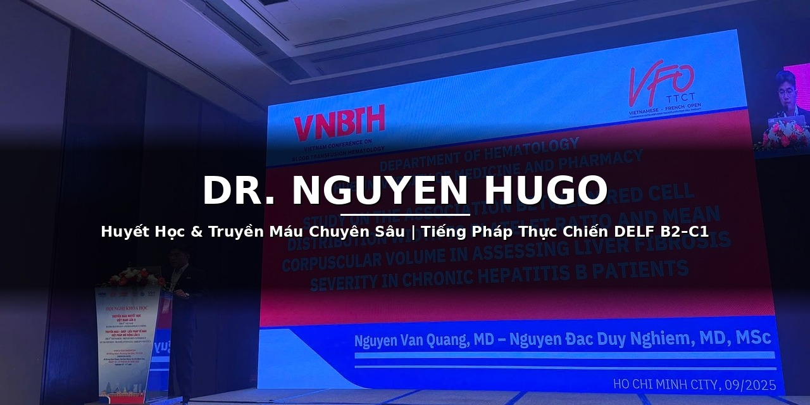

# Dr. Nguyen Hugo | Huyết Học & DELF B2-C1

Xin chào! Tôi là Dr. Nguyen Hugo — bác sĩ Huyết học, đồng thời chia sẻ tài liệu và chiến thuật luyện thi tiếng Pháp DELF B2–C1.

🌐 Trang của tôi: https://hugonguyen508-svg.github.io/

📚 Tài liệu nổi bật: [Cẩm nang chiến thuật đọc hiểu DELF B2 (v4.1)](https://hugonguyen508-svg.github.io/assets/cam-nang-chien-thuat-doc-hieu-delf-b2-v4.1.md)

- 🔭 Đang làm việc: Huyết học lâm sàng & truyền máu
- 🌱 Đang học / chia sẻ: tiếng Pháp DELF B2–C1
- 💬 Hỏi tôi về: Huyết học, truyền máu và luyện thi DELF
